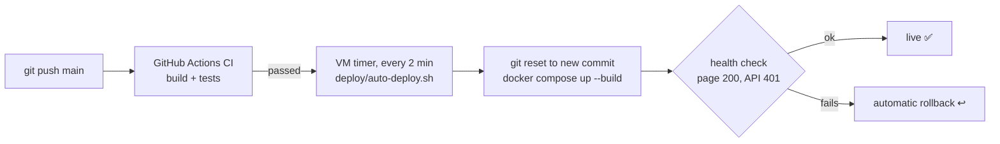

# 📚 Library Management System

A full-stack library app where **members** browse a catalog and borrow, renew and return books, and **librarians** manage the catalog, lend books at the desk, track overdue loans and follow usage on a dashboard. It is built with **Spring Boot 3 (Java 17)** and **Angular 17**. Real lending rules are enforced on the server: a 3-book limit, 14-day loans, one renewal, $0.25/day late fines, and no new borrowing while a loan is overdue. Every rule has a test. Role-based security uses JWT, and **optimistic locking** stops two members from borrowing the last copy at the same moment. The whole stack runs with one `docker compose up`.

> Built as a portfolio project. The code is commented as a learning resource, and
> **[docs/HOW-IT-WORKS.md](docs/HOW-IT-WORKS.md)** walks through every layer in detail.

---

## Features

### Members
- **Catalog**: card grid with covers, search by title, author or ISBN, a genre filter, an "available only" toggle and pagination.
- **Borrow** in one click. When a rule blocks it, the button is disabled and shows the reason (*No copies available*, *Limit reached (3 books)*, *You already have this book*, *Return your overdue book first*).
- **My loans**: due dates, a "days left" or "N days overdue" badge, **Renew** (once, if not overdue) and **Return** buttons, fines accrued so far, and the borrowing history.
- Self-registration. A new account is always a member.

### Librarians
- **Dashboard**: titles, copies, on loan, overdue count, members and fines outstanding, plus charts for loans per month (last 6 months), copies on the shelf vs. on loan, and the top 5 most borrowed books.
- **Manage books**: a sortable, searchable table, an add/edit form and an inline delete confirmation. Deleting is refused while copies are on loan, and total copies can't go below the number on loan.
- **Loans**: lend a book to a member at the desk, filter by *Active / Overdue / Returned*, and mark a loan returned (the fine is calculated automatically).
- **Members**: a searchable list with active, overdue and all-time loan counts, linking to each member's loans.

### Under the hood
- Stateless **JWT** authentication. The role is in the token and in the login response; passwords are hashed with **BCrypt**.
- Two layers of authorization: the URL level (401) and **`@PreAuthorize`** on methods (403 JSON). Ownership checks mean members can only see or touch their own loans.
- **Optimistic locking** (`@Version`) on books prevents double-lending the last copy.
- Loan status (ACTIVE, OVERDUE or RETURNED) is **computed from dates through an injected `Clock`**, never stored, so it is always correct and easy to test.
- Money uses `BigDecimal` and `NUMERIC(8,2)`.
- **Flyway** migrations run on both H2 (dev and tests) and PostgreSQL (prod).
- Consistent JSON errors (`ApiError`) for 400, 401, 403, 404 and 409.
- **35 backend tests** (Mockito unit tests plus MockMvc integration tests) and **20 frontend tests**, run in GitHub Actions CI.
- Swagger UI at `/swagger-ui.html`.

---

## Tech stack

| Layer | Technology |
|---|---|
| Frontend | Angular 17 (standalone components, signals, new `@if`/`@for` control flow, reactive forms, lazy routes), TypeScript, SCSS, Chart.js 4 |
| Backend | Java 17, Spring Boot 3.5 (Web, Data JPA, Security, Validation), JJWT 0.12, springdoc-openapi |
| Database | PostgreSQL 16 (prod), H2 in PostgreSQL mode (dev and tests), Flyway migrations |
| Testing | JUnit 5, Mockito, AssertJ, Spring MockMvc; Jasmine and Karma (headless Chrome) |
| DevOps | Docker multi-stage builds, nginx, Docker Compose, GitHub Actions |

---

## Quick start

### Option A: run locally (no database to install)

Requirements: **Java 17+** and **Node 18+**.

```bash
# Terminal 1 - backend on http://localhost:8083 (in-memory H2 database, demo data seeded)
cd backend
./mvnw spring-boot:run

# Terminal 2 - frontend on http://localhost:4303 (proxies /api to the backend)
cd frontend
npm install
npm start
```

Open **http://localhost:4303**.

Extras: Swagger UI at http://localhost:8083/swagger-ui.html, and the H2 console at http://localhost:8083/h2-console (JDBC URL `jdbc:h2:mem:library`, user `sa`, no password).

### Option B: Docker (PostgreSQL + backend + nginx)

```bash
docker compose up --build
```

Open **http://localhost:8093**. Data is kept in a Docker volume; use `docker compose down -v` to reset it.

### Demo accounts

| Role | Email | Password |
|---|---|---|
| Librarian | `librarian@example.com` | `password123` |
| Member | `member@example.com` | `password123` |
| More members | `alex@`, `priya@`, `sam@`, `olivia@example.com` | `password123` |

The login page has **"Use librarian demo"** and **"Use member demo"** links. Alex and Olivia each have an overdue loan, so you can see the overdue rules in action.

### Running the tests

```bash
cd backend && ./mvnw verify                                        # 35 tests
cd frontend && npx ng test --watch=false --browsers=ChromeHeadless  # 20 tests
```

---

## Running in IntelliJ IDEA or VS Code

Both editors work. The repo includes ready-made run configurations for each one
(`.run/` for IntelliJ, `.vscode/` for VS Code), so you don't have to set anything up by hand.

**You need:** JDK 17+, Node.js 18+ (Angular 17 requires 18.13 or newer) and npm. You don't need Maven:
the project uses the Maven Wrapper (`mvnw`).

| | Backend (Spring Boot API) | Frontend (Angular) |
|---|---|---|
| URL | http://localhost:8083 (Swagger: `/swagger-ui.html`) | http://localhost:4303 |
| Entry point | `backend/src/main/java/com/portfolio/library/LibraryApplication.java` | `frontend/` → `npm start` |

Start the **backend first**, then the frontend. The frontend dev server forwards `/api` calls to port 8083.
Then open http://localhost:4303 and use **librarian@example.com** or **member@example.com** (password `password123`).

### IntelliJ IDEA (Community or Ultimate)

1. **Open the project:** *File → Open…* and select the **repository root folder** (the one containing `backend/` and `frontend/`).
   If IntelliJ doesn't import Maven automatically, right-click `backend/pom.xml` → **Add as Maven Project**.
2. **Set the JDK:** *File → Project Structure → Project → SDK* → choose a **17** (or newer) JDK.
   If none is listed, use *Add SDK → Download JDK* (for example Eclipse Temurin 17).
3. **Use the Maven Wrapper:** *Settings → Build, Execution, Deployment → Build Tools → Maven* → **Maven home path: Use Maven wrapper**.
4. **Run the backend:** choose **Backend (Spring Boot)** in the run-configuration dropdown (top right) and click ▶ Run or 🐞 Debug.
   Or open `LibraryApplication.java` and click the green ▶ next to `main`. Wait for `Started LibraryApplication in … seconds` in the console.
5. **Run the frontend:**
   - **Ultimate:** choose the **Frontend (npm start)** run configuration and click ▶. The first time, right-click `frontend/package.json` → **Run 'npm install'**.
   - **Community** (no JavaScript support): open the **Terminal** tool window and run:
     ```bash
     cd frontend
     npm install   # first time only
     npm start
     ```
6. **Run the tests:** choose the **Backend tests** configuration, or right-click `backend/src/test/java` → **Run 'All Tests'**.
   Frontend tests run in the terminal: `cd frontend && npx ng test --watch=false --browsers=ChromeHeadless`.

> **Tip:** in Ultimate, the *Services* tool window shows the Spring Boot app with its endpoints and health.
> To debug, set breakpoints in a controller or service and start **Backend (Spring Boot)** with 🐞 Debug.

### VS Code

1. **Open the folder:** *File → Open Folder…* and select the **repository root**.
2. **Install the recommended extensions** when VS Code prompts you (they're listed in `.vscode/extensions.json`):
   - **Extension Pack for Java**: Java language support, Maven, debugger, test runner
   - **Spring Boot Extension Pack**: Spring Boot tools + Spring Boot Dashboard
   - **Angular Language Service**: template autocompletion and errors

   When the Java extension asks, choose **Trust** and let it import the Maven project
   (the status bar shows "Java: Ready" when it's done).
3. **Run everything with one click:** open *Run and Debug* (Ctrl/Cmd + Shift + D), pick
   **Full stack (backend + frontend)** and press ▶. This starts the Spring Boot API with the debugger attached,
   runs `npm start`, and opens Chrome with the Angular debugger attached.
   The first time, run *Terminal → Run Task… → **Frontend: npm install*** before pressing ▶.
4. **Or run the pieces separately:**
   - Backend: **Backend (Spring Boot)** in *Run and Debug*, or ▶ next to the app in the *Spring Boot Dashboard*,
     or *Terminal → Run Task… → **Backend: run (mvnw spring-boot:run)***.
   - Frontend: *Terminal → Run Task… → **Frontend: npm start***.
5. **Tests:** the *Testing* panel (beaker icon) lists every JUnit test. You can also use
   *Terminal → Run Task… → **Backend: tests*** / **Frontend: tests**.

### Troubleshooting

| Problem | Fix |
|---|---|
| `Port 8083 was already in use` | Another app (or a previous run) is using it. Stop it, or change `server.port` in `backend/src/main/resources/application.yml` **and** `target` in `frontend/proxy.conf.json`. |
| `Port 4303 is already in use` | Run `npx ng serve --port <other>` inside `frontend/`. |
| Login fails / "Cannot reach the server" | The backend isn't running, or not on port 8083. Start it first. |
| Java errors such as "release version 17 not supported" | The project/IDE is using an older JDK. Select JDK 17+ (step 2 above). |
| Red imports in VS Code | Run *Command Palette → **Java: Clean Java Language Server Workspace*** and reload. |
| `ng: command not found` | Use `npm start` / `npx ng …` (they use the project's local Angular CLI) after `npm install`. |
| H2 console | http://localhost:8083/h2-console, JDBC URL `jdbc:h2:mem:library`, user `sa`, empty password (the DB lives in memory and resets on restart). |

## Screenshots

| Catalog (member) | My loans (member) |
|---|---|
|  |  |

| Dashboard (librarian) | Loans, overdue filter (librarian) |
|---|---|
|  |  |

| Manage books (librarian) | Login |
|---|---|
|  |  |

---

## Continuous deployment

Every push to `main` is built and tested by GitHub Actions (`.github/workflows/ci.yml`). If CI passes,
the new version is **deployed automatically** to a home-lab VM (http://192.168.86.15:8093).



The VM sits in a private network that GitHub can't reach, so the VM **pulls**: a systemd timer runs
[`deploy/auto-deploy.sh`](deploy/auto-deploy.sh), which only deploys commits whose CI checks succeeded, and rolls back if the
build or the health check fails. This avoids opening any port to the internet, and avoids self-hosted
runners, which GitHub advises against for public repositories.

**One-time setup on the VM** (user in the `docker` group, repo cloned to `~/apps/library-management`):

```bash
cd ~/apps/library-management && ./deploy/install-auto-deploy.sh
journalctl -u auto-deploy@library-management -f        # watch deployments
```

Secrets (DB password, `JWT_SECRET`) live in an untracked `docker-compose.override.yml` on the VM and are never committed.

## Documentation

**[docs/HOW-IT-WORKS.md](docs/HOW-IT-WORKS.md)** is a detailed guide covering:

- the architecture and the request lifecycle (with diagrams)
- security in depth
- the data model and every business rule (where it is enforced and which test covers it)
- the API reference
- a layer-by-layer code walkthrough
- testing, configuration and deployment
- interview talking points

---

## Project structure

```
library-management/
├── backend/                     Spring Boot REST API
│   ├── src/main/java/com/portfolio/library/
│   │   ├── auth/                register / login / me
│   │   ├── book/                catalog (entity with @Version, search, CRUD)
│   │   ├── loan/                borrowing rules, LoanPolicy, computed status
│   │   ├── member/              librarian member list with loan counts
│   │   ├── stats/               dashboard aggregates
│   │   ├── user/                User entity (implements UserDetails) + Role
│   │   ├── security/            JWT creation/validation + request filter
│   │   ├── config/              security, clock, OpenAPI, demo data seeder
│   │   └── common/              ApiError, exceptions, global handler, PageResponse
│   ├── src/main/resources/      application.yml, application-prod.yml, Flyway SQL
│   └── src/test/java/...        unit tests (Mockito) + integration tests (MockMvc)
├── frontend/                    Angular 17 single-page app
│   └── src/app/
│       ├── core/                models, auth (service, interceptor, guards), API services
│       ├── shared/              error messages, pipes, book cover, pagination
│       └── features/            auth, catalog, my-loans, dashboard, manage-books, loans, members
├── docs/                        HOW-IT-WORKS.md + screenshots
├── docker-compose.yml           Postgres + backend + frontend (nginx)
└── .github/workflows/ci.yml     build + test both apps on every push
```
