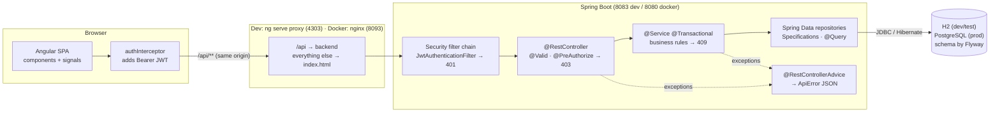
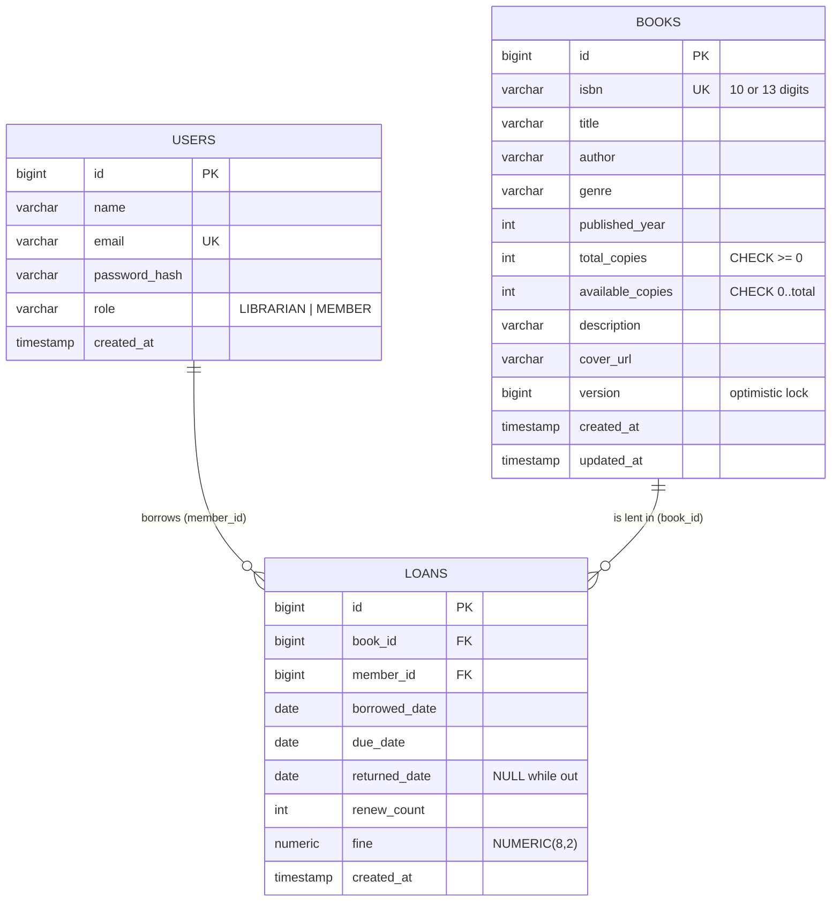
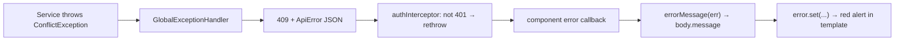

# How the Library Management System Works

This guide explains the whole application, from the button a member clicks to the row written in the database. It is written for developers who are new to Spring Boot and Angular, and for anyone preparing to talk about the project in an interview.

**Contents**

1. [Overview & features](#1-overview--features)
2. [Tech stack and why](#2-tech-stack-and-why)
3. [Architecture](#3-architecture)
4. [Project structure](#4-project-structure)
5. [Request lifecycle: borrowing a book](#5-request-lifecycle-borrowing-a-book)
6. [Authentication, authorization & roles](#6-authentication-authorization--roles)
7. [Data model](#7-data-model)
8. [Business rules](#8-business-rules)
9. [API reference](#9-api-reference)
10. [Backend, layer by layer](#10-backend-layer-by-layer)
11. [Frontend explained](#11-frontend-explained)
12. [Error handling end-to-end](#12-error-handling-end-to-end)
13. [Testing](#13-testing)
14. [Configuration, profiles & environment variables](#14-configuration-profiles--environment-variables)
15. [Docker & deployment](#15-docker--deployment)
16. [Interview talking points](#16-interview-talking-points)
17. [Glossary](#17-glossary)

---

## 1. Overview & features

A small public library needs to know **which books it owns**, **who has borrowed what**, and **what is late**. This app covers those needs for two kinds of users.

| | Member | Librarian |
|---|---|---|
| Browse and search the catalog | ✅ | ✅ |
| Borrow a book for themselves | ✅ | n/a (they lend instead) |
| Lend a book to a member at the desk | ❌ | ✅ |
| See loans | own loans only | all loans, filterable |
| Renew / return | own loans only | any loan |
| Add / edit / delete books | ❌ (403) | ✅ |
| Member list with loan counts | ❌ (403) | ✅ |
| Statistics dashboard | ❌ (403) | ✅ |

**The lending policy** (in `LoanPolicy.java`):

- A loan lasts **14 days**.
- A member may hold **at most 3 books** at once.
- A loan can be **renewed once**, adding another 14 days, and only if it is not overdue.
- A member with an **overdue** loan can't borrow anything else until it is returned.
- A member can't hold **two copies of the same title**.
- Returning late costs **$0.25 per day**.

**Demo data.** On startup, `DemoDataSeeder` creates:

- 1 librarian and 5 members
- 26 classic books in 12 genres, with covers from Open Library
- 25 returned loans spread over the last 6 months, so the charts have data
- 8 current loans, two of which are overdue

All dates are relative to today, so the demo always looks current.

---

## 2. Tech stack and why

| Choice | Why it was chosen | What it replaces / alternatives |
|---|---|---|
| **Java 17 + Spring Boot 3.5** | The most common enterprise backend stack. Auto-configuration means little boilerplate, and the ecosystem (Security, Data JPA, Validation) covers every need here. | Node/Express, .NET, Django |
| **Spring Data JPA / Hibernate** | Repositories are interfaces, and queries are often derived from method names. It supports optimistic locking (`@Version`) out of the box. | Plain JDBC, jOOQ, MyBatis |
| **Spring Security + JJWT** | The standard way to secure Spring apps. JWT keeps the API **stateless**: no server sessions, so it scales horizontally. | Session cookies, OAuth2 / Keycloak |
| **Bean Validation** | Declarative input rules (`@NotBlank`, `@Pattern`) on request DTOs, which are checked automatically. | Manual `if` checks |
| **Flyway** | The database schema is versioned in plain SQL files, applied automatically, and reviewed like code. | `ddl-auto=update` (dangerous in prod), Liquibase |
| **H2 (PostgreSQL mode) + PostgreSQL** | Zero-install development and fast tests on H2, a real database in production, and one set of migrations for both. | Testcontainers (more realistic, needs Docker) |
| **Angular 17** | A full framework (router, HTTP, forms, DI, testing) with strong typing. This app uses the modern features: standalone components, signals, and `@if`/`@for`. | React, Vue |
| **Chart.js** | A small, well-documented canvas charting library. | ngx-charts, D3 |
| **Docker + nginx + Compose** | One command runs Postgres, the API and the static frontend exactly as in production. nginx serves the SPA and proxies `/api`, so no CORS is needed. | Manual installs |
| **GitHub Actions** | Free CI that builds and tests both apps on every push. | Jenkins, GitLab CI |

---

## 3. Architecture



**Layers and their single responsibility:**

| Layer | Knows about | Must NOT know about |
|---|---|---|
| Angular components | what to show, user interactions | URLs (they use API services), tokens (the interceptor handles them) |
| Angular API services | URLs, HTTP verbs, JSON shapes | UI |
| Security filter | tokens, users | business rules |
| Controllers | HTTP (paths, status codes, request bodies, roles) | SQL, business rules |
| Services | business rules, transactions | HTTP, JSON |
| Repositories | queries | business rules |
| Entities | data plus invariants on their own fields | other entities' rules |

**Why the browser never calls the backend's port directly:** in development, `ng serve` proxies `/api` (see `proxy.conf.json`); in Docker, nginx does (see `nginx.conf`). The page and the API therefore share one origin, which keeps CORS out of the picture in Docker. In development the browser still sends its `Origin: http://localhost:4303` header through the proxy, so that origin is listed in `app.cors.allowed-origins`. The proxy uses `"changeOrigin": false` so that the Host header and the Origin stay consistent.

---

## 4. Project structure

Every file, one line each.

```
library-management/
├── README.md                              Pitch, features, quick start, demo logins
├── docker-compose.yml                     Postgres + backend + frontend(nginx) on port 8093
├── .gitignore                             Build outputs, node_modules, IDE files, .env
├── .github/workflows/ci.yml               CI: backend ./mvnw verify, frontend tests + prod build
├── docs/
│   ├── HOW-IT-WORKS.md                    This guide
│   └── screenshots/*.png                  Screenshots used by the README
│
├── backend/
│   ├── pom.xml                            Maven build: Spring Boot 3.5.6, JJWT, springdoc, H2, Postgres
│   ├── mvnw, mvnw.cmd, .mvn/wrapper/      Maven Wrapper - always build with ./mvnw
│   ├── Dockerfile                         Multi-stage: Maven build → JRE-only runtime, non-root user
│   ├── .dockerignore                      Keeps target/ out of the Docker build context
│   └── src/
│       ├── main/java/com/portfolio/library/
│       │   ├── LibraryApplication.java            main(); @SpringBootApplication
│       │   ├── auth/
│       │   │   ├── AuthController.java            POST /register, POST /login, GET /me
│       │   │   ├── AuthService.java               BCrypt check, MEMBER-only registration, issues JWT
│       │   │   └── dto/
│       │   │       ├── AuthResponse.java          { token, user }
│       │   │       ├── LoginRequest.java          { email, password } with @NotBlank
│       │   │       ├── RegisterRequest.java       { name, email, password } - no role field on purpose
│       │   │       └── UserResponse.java          { id, name, email, role } - never the password hash
│       │   ├── book/
│       │   │   ├── Book.java                      Entity; @Version; checkOutCopy/returnCopy/changeTotalCopies
│       │   │   ├── BookController.java            /api/books; writes are @PreAuthorize LIBRARIAN
│       │   │   ├── BookRepository.java            Spring Data + genres + sum of copies
│       │   │   ├── BookService.java               Unique ISBN, stale-version check, delete/shrink rules
│       │   │   ├── BookSpecifications.java        Composable filters: text, genre, available only
│       │   │   └── dto/
│       │   │       ├── BookRequest.java           Validated input (ISBN 10/13 digits, year, copies, version)
│       │   │       └── BookResponse.java          Output incl. availableCopies and version
│       │   ├── loan/
│       │   │   ├── Loan.java                      Entity; statusOn(today), renew, markReturned, currentFine
│       │   │   ├── LoanController.java            borrow / return / renew / me / list (librarian)
│       │   │   ├── LoanPolicy.java                14 days, 3 books, 1 renewal, $0.25/day, fineFor()
│       │   │   ├── LoanRepository.java            Rule queries, entity graphs, stats and per-member counts
│       │   │   ├── LoanService.java               All lending rules + ownership, @Transactional
│       │   │   ├── LoanSpecifications.java        Status (date-based), member and book filters
│       │   │   ├── LoanStatus.java                ACTIVE / OVERDUE / RETURNED (computed, never stored)
│       │   │   └── dto/
│       │   │       ├── BorrowRequest.java         { bookId, memberId? }
│       │   │       └── LoanResponse.java          Flattened loan + derived status/daysUntilDue/fine/canRenew
│       │   ├── member/
│       │   │   ├── MemberController.java          GET /api/members (class-level @PreAuthorize)
│       │   │   ├── MemberService.java             Page of members + 3 GROUP BY count queries (no N+1)
│       │   │   └── dto/
│       │   │       ├── MemberLoanCount.java       (memberId, count) row from a JPQL constructor query
│       │   │       └── MemberResponse.java        Member + active/overdue/total loans
│       │   ├── stats/
│       │   │   ├── StatsController.java           GET /api/stats (librarian)
│       │   │   ├── StatsService.java              Totals, fines, top 5, 6-month buckets
│       │   │   └── dto/
│       │   │       ├── BookBorrowCount.java       Top-borrowed row
│       │   │       ├── MonthlyCount.java          { month: "2026-10", count }
│       │   │       └── StatsResponse.java         Everything the dashboard shows
│       │   ├── user/
│       │   │   ├── Role.java                      LIBRARIAN / MEMBER + "ROLE_" authority
│       │   │   ├── User.java                      Entity implementing UserDetails
│       │   │   └── UserRepository.java            findByEmailIgnoreCase, countByRole, Specifications
│       │   ├── security/
│       │   │   ├── JwtService.java                Sign/verify tokens; claims sub, uid, name, role
│       │   │   └── JwtAuthenticationFilter.java   Bearer header → SecurityContext (once per request)
│       │   ├── config/
│       │   │   ├── SecurityConfig.java            Filter chain, stateless, 401 entry point, BCrypt, CORS, @EnableMethodSecurity
│       │   │   ├── ClockConfig.java               Clock bean (fixed in tests)
│       │   │   ├── OpenApiConfig.java             Swagger UI metadata + bearer auth scheme
│       │   │   └── DemoDataSeeder.java            Demo users, 26 books, loan history (if app.seed-demo-data)
│       │   └── common/
│       │       ├── ApiError.java                  Uniform error JSON
│       │       ├── BadRequestException.java       → 400
│       │       ├── ConflictException.java         → 409 (business rules)
│       │       ├── ResourceNotFoundException.java → 404
│       │       ├── GlobalExceptionHandler.java    Exceptions → status + ApiError
│       │       └── PageResponse.java              Stable pagination JSON
│       ├── main/resources/
│       │   ├── application.yml                    Dev defaults: port 8083, H2, JWT, CORS, seeding
│       │   ├── application-prod.yml               Postgres via env vars, port $PORT/8080, no H2 console
│       │   └── db/migration/V1__create_tables.sql users, books (version, CHECKs), loans, indexes
│       └── test/java/com/portfolio/library/
│           ├── ApiIntegrationTest.java            13 end-to-end MockMvc tests (H2, security, rules, locking)
│           ├── book/BookServiceTest.java          6 Mockito tests (delete/shrink/version/ISBN rules)
│           ├── loan/LoanServiceTest.java          14 Mockito tests (every lending rule, ownership)
│           └── loan/LoanTest.java                 2 plain tests (computed status, fine math)
│
└── frontend/
    ├── package.json / package-lock.json   Dependencies; "npm start" = ng serve --port 4303
    ├── angular.json                       Build/serve/test config (proxy, port, budgets)
    ├── proxy.conf.json                    Dev proxy: /api → http://localhost:8083
    ├── tsconfig*.json                     Strict TypeScript + strict templates
    ├── Dockerfile                         Node build → nginx runtime
    ├── nginx.conf                         Static files, SPA fallback, /api proxy, caching
    ├── .dockerignore, .editorconfig, .gitignore, .vscode/   Tooling defaults
    └── src/
        ├── index.html                     The single HTML page (<app-root>)
        ├── main.ts                        bootstrapApplication(AppComponent, appConfig)
        ├── styles.scss                    Global design system (colors, buttons, inputs, badges, tables)
        ├── favicon.ico, assets/           Static assets
        └── app/
            ├── app.component.{ts,html,scss}   Shell: role-aware navbar + <router-outlet>
            ├── app.config.ts              Router (with input binding) + HttpClient (with interceptor)
            ├── app.routes.ts              Lazy routes + roleGuard + data.roles
            ├── core/
            │   ├── models.ts              TypeScript mirrors of every backend DTO
            │   ├── auth/
            │   │   ├── auth.service.ts    Login/register/logout; signals currentUser, role, isLibrarian
            │   │   ├── auth.interceptor.ts Adds Bearer token; logs out on 401 (not 403)
            │   │   ├── auth.guard.ts      authGuard, guestGuard, roleGuard, homeRedirectGuard
            │   │   └── *.spec.ts          Tests for service, interceptor and role guard
            │   └── api/
            │       ├── http-params.ts     Object → HttpParams, skipping empty values
            │       ├── book.service.ts    /api/books (+ spec)
            │       ├── loan.service.ts    /api/loans
            │       ├── member.service.ts  /api/members
            │       └── stats.service.ts   /api/stats
            ├── shared/
            │   ├── error-message.ts       HttpErrorResponse → user-friendly sentence
            │   ├── loan-status.pipe.ts    "OVERDUE" → "Overdue"; dueLabel() "3 days left" (+ spec)
            │   ├── book-cover.component.ts Cover image with colored placeholder fallback
            │   └── pagination.component.ts Prev / Page x of y / Next (@Input + @Output)
            └── features/
                ├── auth/                  login (demo links), register, shared auth-page.scss
                ├── catalog/               card grid, filters, Borrow; borrow-rules.ts (+ spec)
                ├── my-loans/              current loans (renew/return), fines, history
                ├── dashboard/             stat cards + 3 Chart.js charts (librarian)
                ├── manage-books/          book-list (table, sort, inline delete) + book-form (add/edit)
                ├── loans/                 loan-admin: lend form, status filter, mark returned
                └── members/               member-list with loan counts
```

---

## 5. Request lifecycle: borrowing a book

Maya (a member) clicks **Borrow** on *Animal Farm*. This is everything that happens, in order.

```mermaid
sequenceDiagram
    autonumber
    actor Maya
    participant Cat as CatalogComponent
    participant LS as LoanService (Angular)
    participant Int as authInterceptor
    participant Px as Proxy (ng serve / nginx)
    participant F as JwtAuthenticationFilter
    participant C as LoanController
    participant S as LoanService (Java)
    participant R as Repositories
    participant DB as Database

    Maya->>Cat: click "Borrow"
    Cat->>Cat: borrowingId.set(id) → button disabled
    Cat->>LS: borrow(bookId)
    LS->>Int: POST /api/loans {"bookId":26}
    Int->>Px: + Authorization: Bearer eyJ...
    Px->>F: forward to Spring Boot
    F->>F: verify signature + expiry, read email
    F->>R: findByEmailIgnoreCase(email)
    R->>DB: SELECT * FROM users WHERE ...
    F->>F: SecurityContext ← User (ROLE_MEMBER)
    F->>C: request is authenticated
    C->>C: @Valid BorrowRequest (bookId not null)
    C->>S: borrow(user, request)
    Note over S: @Transactional: BEGIN
    S->>R: books.findById(26)
    S->>R: overdue? count active? same book?
    R->>DB: 3 small indexed queries on loans
    S->>S: availableCopies > 0 ?
    S->>S: book.checkOutCopy()  (3 → 2)
    S->>R: books.saveAndFlush(book)
    R->>DB: UPDATE books SET available_copies=2, version=v+1 WHERE id=26 AND version=v
    S->>R: loans.save(new Loan(book, Maya, today))
    R->>DB: INSERT INTO loans (...)
    Note over S: COMMIT
    S-->>C: LoanResponse (status ACTIVE, due today+14)
    C-->>Px: 201 Created + JSON
    Px-->>LS: response
    LS-->>Cat: Loan
    Cat->>Cat: notice.set("You borrowed..."), page.update(copies-1), myLoans.update(+loan)
    Cat-->>Maya: success banner; card shows "2 of 3 available"
```

**Step by step, with the files involved:**

1. **Click → component** (`catalog.component.html`). The button is bound with `(click)="borrow(card.book)"`. It is already disabled when `borrowBlockReason()` found a problem, so a doomed request is never sent in the normal case.
2. **Component → API service** (`catalog.component.ts` → `core/api/loan.service.ts`). `this.loans.borrow(book.id)` returns an Observable. Nothing happens until `.subscribe()` is called.
3. **Interceptor** (`core/auth/auth.interceptor.ts`) clones the request and adds `Authorization: Bearer <token>`. The token comes from `localStorage['library.token']`.
4. **Proxy** (`proxy.conf.json` / `nginx.conf`). The browser called its own origin; the proxy forwards `/api/**` to Spring Boot.
5. **Security filter** (`JwtAuthenticationFilter`) verifies the token with the secret key and loads the user from the database. That is how the user's **current** role is known. The filter then stores the user in the `SecurityContext`. A bad or missing token would end the request here with **401**.
6. **Controller** (`LoanController.borrow`). Spring parses the JSON into `BorrowRequest`, `@Valid` checks it (400 if `bookId` is missing), and `@AuthenticationPrincipal` hands over the `User`.
7. **Service** (`LoanService.borrow`) runs inside one database transaction (`@Transactional`):
   - `resolveBorrower` decides whom the loan is for. A member always borrows for themselves; a librarian must name a member.
   - It checks the four rules in order (overdue → limit → duplicate → availability). Any failure throws `ConflictException`, which becomes a 409.
   - `book.checkOutCopy()` decrements the stock. `saveAndFlush` sends the `UPDATE ... WHERE version = ?` **immediately**, so a concurrent borrow of the last copy fails *here*, inside the transaction (see §10.4).
   - It inserts the `Loan` with `dueDate = today + 14`.
8. **Commit.** Both writes become visible together, or neither does.
9. **Response.** `LoanResponse.from(loan, today)` adds the computed `status`, `daysUntilDue`, `fine` and `canRenew` fields. Jackson writes the JSON, and `@ResponseStatus(CREATED)` makes the status **201**.
10. **Back in Angular.** The `next` callback updates three signals. Because the template reads those signals, Angular re-renders only what changed: the success banner, the card's availability, and "You have 3 of 3 books on loan".

**If something fails**, the `error` callback receives an `HttpErrorResponse`. `errorMessage(err)` extracts the server's `message` (for example *"Borrowing limit reached: a member can have at most 3 books at a time."*), and the catalog reloads in case the stock changed.

---

## 6. Authentication, authorization & roles

### 6.1 Passwords: BCrypt

Passwords are never stored. `AuthService.register` stores `passwordEncoder.encode(password)`, which produces a **BCrypt** hash like `$2a$10$N9qo8uLOickgx2ZMRZoMye...`. Inside that string:

- `2a` is the algorithm version.
- `10` is the cost: 2¹⁰ rounds, deliberately slow (about 100 ms).
- The next 22 characters are a random **salt**, so identical passwords produce different hashes.

At login, `passwordEncoder.matches(raw, hash)` re-hashes the attempt with the stored salt and compares the result. If the database leaks, an attacker has to brute-force every hash separately, and slowly.

### 6.2 Tokens: JWT

After a successful login or registration, `JwtService.generateToken` builds:

```
eyJhbGciOiJIUzM4NCJ9 . eyJzdWIiOiJtZW1iZXJAZXhhbXBsZS5jb20iLCJ1aWQiOjIs... . 3q2-Vx...
       header                             payload (claims)                        signature
```

The decoded payload, captured from the running app:

```json
{"sub":"member@example.com","uid":2,"name":"Maya Member","role":"MEMBER","iat":1791994345,"exp":1792080745}
```

| Claim | Meaning |
|---|---|
| `sub` | Subject: the user's email, used to load the user |
| `uid` | User id (convenience for clients) |
| `name` | Display name (convenience) |
| `role` | `LIBRARIAN` or `MEMBER` (convenience; the server re-reads the role from the database) |
| `iat` / `exp` | Issued-at / expiry, in epoch seconds. The token is valid for 24 h (`app.jwt.expiration-ms`) |

The signature is an HMAC computed with the secret `app.jwt.secret`. JJWT chooses HS256, HS384 or HS512 from the key length; the dev key is 48 bytes, so it uses HS384. Anyone can *read* a JWT, but nobody can *change* one without the key: editing `"role":"MEMBER"` to `"LIBRARIAN"` breaks the signature, and the filter rejects the token.

**Why stateless?** The server keeps no session. Any backend instance can verify any token, so you can run several instances behind a load balancer. The trade-off is that you can't easily revoke a token before it expires (see §16).

### 6.3 The filter chain

`SecurityConfig.securityFilterChain` configures:

- `csrf` disabled. CSRF abuses cookies, and the app uses none.
- `sessionCreationPolicy(STATELESS)`.
- `/api/auth/login`, `/api/auth/register`, Swagger and the H2 console are `permitAll()`; **everything else** is `authenticated()`.
- `authenticationEntryPoint(new HttpStatusEntryPoint(UNAUTHORIZED))` answers **401** when a protected URL is called without valid authentication.
- `JwtAuthenticationFilter` is added before Spring's username/password filter.

### 6.4 Roles and `@PreAuthorize`

`User.getAuthorities()` returns `ROLE_LIBRARIAN` or `ROLE_MEMBER`. `@EnableMethodSecurity` activates annotations like:

```java
@PostMapping
@ResponseStatus(HttpStatus.CREATED)
@PreAuthorize("hasRole('LIBRARIAN')")     // checks authority "ROLE_LIBRARIAN"
public BookResponse create(@Valid @RequestBody BookRequest request) { ... }
```

Spring wraps the controller in a proxy that evaluates the expression **before** the method runs. If it is false, the proxy throws `AccessDeniedException`, and `GlobalExceptionHandler.handleAccessDenied` turns that into a **403** with JSON. `MemberController` puts the annotation on the **class**, so every method in it is librarian-only by default.

| Endpoint | Rule |
|---|---|
| `POST/PUT/DELETE /api/books` | `@PreAuthorize("hasRole('LIBRARIAN')")` |
| `GET /api/loans` | `@PreAuthorize("hasRole('LIBRARIAN')")` |
| `GET /api/members` | class-level `@PreAuthorize("hasRole('LIBRARIAN')")` |
| `GET /api/stats` | `@PreAuthorize("hasRole('LIBRARIAN')")` |
| everything else | any authenticated user, plus ownership checks in the service |

### 6.5 Ownership (data-level authorization)

Roles answer "may this *kind* of user call this endpoint?". Ownership answers "may *this* user touch *this* record?", and only the service can answer it:

```java
private Loan findAccessible(User caller, Long loanId) {
    var loan = caller.isLibrarian()
            ? loans.findById(loanId)                              // staff: any loan
            : loans.findByIdAndMemberId(loanId, caller.getId());   // member: only their own
    return loan.orElseThrow(() -> new ResourceNotFoundException("Loan " + loanId + " not found"));
}
```

A member asking for someone else's loan gets **404**, not 403. A 403 would confirm that the loan id exists. A member trying to borrow *for* someone else (`memberId` set to another id) gets **403**, because that is an attempt at a forbidden action rather than a lookup.

### 6.6 401 vs 403 at a glance

| Situation | Status | Who answers |
|---|---|---|
| No token, malformed token, expired token, deleted user | **401** | `HttpStatusEntryPoint` (security chain) |
| Wrong email/password at login | **401** + JSON | `GlobalExceptionHandler` (`BadCredentialsException`) |
| Valid token, wrong role | **403** + JSON | `@PreAuthorize` → `GlobalExceptionHandler` |
| Valid token, someone else's loan | **404** + JSON | `LoanService.findAccessible` |

### 6.7 The frontend side

- **`AuthService`** stores the token and user in `localStorage` (`library.token`, `library.user`) and exposes signals: `currentUser`, `isLoggedIn`, `role`, `isLibrarian`, `isMember`. `homeUrl()` returns `/dashboard` for librarians and `/catalog` for members.
- **`authInterceptor`** adds the header and calls `logout()` on a **401**, because the session is over. It does **not** log out on a **403**: the user is still logged in, they just can't do that one thing.
- **Guards** (`auth.guard.ts`):
  - `roleGuard` reads `route.data['roles']`. It sends anonymous users to `/login` and users with the wrong role to their home page.
  - `guestGuard` keeps logged-in users off `/login`.
  - `homeRedirectGuard` routes `/` by role.
- **The navbar** (`app.component.html`) shows different links per role with `@if (auth.isLibrarian())`.

> Guards and hidden buttons are **UX, not security**. Anyone can change JavaScript in their browser. The backend checks above are what actually protect the data, and the integration tests prove it by calling the API directly.

---

## 7. Data model



### `users`

| Column | Type | Notes |
|---|---|---|
| `id` | BIGINT identity | primary key |
| `name` | VARCHAR(100) | |
| `email` | VARCHAR(255) UNIQUE | login name, JWT subject |
| `password_hash` | VARCHAR(255) | BCrypt |
| `role` | VARCHAR(20), default `MEMBER`, CHECK in (LIBRARIAN, MEMBER) | stored as text via `@Enumerated(STRING)` |
| `created_at` | TIMESTAMP | shown as "member since" |

### `books`

| Column | Type | Notes |
|---|---|---|
| `isbn` | VARCHAR(13) UNIQUE | digits only (ISBN-10 may end in X) |
| `title`, `author`, `genre` | VARCHAR | required |
| `published_year` | INTEGER | optional, 1450–2100 |
| `total_copies` | INTEGER CHECK ≥ 0 | copies owned |
| `available_copies` | INTEGER CHECK ≥ 0, and ≤ total | copies on the shelf |
| `description`, `cover_url` | VARCHAR | optional |
| `version` | BIGINT | Hibernate `@Version` counter |
| `created_at`, `updated_at` | TIMESTAMP | set by `@PrePersist` / `@PreUpdate` |

Index: `idx_books_genre`.

### `loans`

| Column | Type | Notes |
|---|---|---|
| `book_id` | FK → books | |
| `member_id` | FK → users | |
| `borrowed_date` | DATE | |
| `due_date` | DATE | borrowed + 14, plus 14 per renewal |
| `returned_date` | DATE NULL | NULL means still out |
| `renew_count` | INTEGER | max 1 |
| `fine` | NUMERIC(8,2) | recorded on return |

Indexes: `(member_id, returned_date)`, `(book_id, returned_date)` and `(borrowed_date)`, matching the rule and stats queries.

### Design decisions in the model

- **Copies are counted, not stored individually.** One row per title, with `total_copies` and `available_copies`, is enough for this domain. A real library tracking barcodes would add a `copies` table (see §16).
- **No `status` column on loans.** The status depends on *today*, so it is computed (`Loan.statusOn(today)`, and the date conditions in `LoanSpecifications`). A stored status would go stale every midnight.
- **Loans are never deleted on return.** Their history drives "top borrowed" and "loans per month".
- **CHECK constraints** duplicate the Java invariants (`available ≤ total`, no negatives) as a safety net.

### Flyway

`V1__create_tables.sql` is run once by Flyway at startup and recorded in `flyway_schema_history`. Hibernate runs with `ddl-auto: validate`: it never changes the schema, it only checks that the entities match it and fails fast if they don't. To evolve the schema, add `V2__...sql`; never edit V1 after it has run anywhere. The same SQL works on H2 (`MODE=PostgreSQL;DATABASE_TO_LOWER=TRUE`) and on PostgreSQL. That is also why there is no PostgreSQL-only partial unique index for "one open loan per member per book" (see §16).

---

## 8. Business rules

Every rule, where it is enforced, and the test(s) that prove it. "UI" means the frontend also reflects the rule for usability, but the **server** is always the authority.

| # | Rule | Enforced in | HTTP | Tests |
|---|---|---|---|---|
| 1 | Can't borrow when no copies are available | `LoanService.borrow` (+ `Book.checkOutCopy` guard, + DB CHECK); UI: `borrowBlockReason` | 409 *No copies of "X" are available right now.* | `LoanServiceTest.borrow_isRejected_whenNoCopiesAreAvailable`, `ApiIntegrationTest.borrowing_isLimitedTo3Books_andToAvailableCopies`, `borrow-rules.spec` |
| 2 | A member holds at most 3 books | `LoanService.borrow` via `countByMemberIdAndReturnedDateIsNull`; UI | 409 *Borrowing limit reached...* | `LoanServiceTest.borrow_isRejected_whenMemberAlreadyHasThreeActiveLoans`, `ApiIntegrationTest.borrowing_isLimitedTo3Books_andToAvailableCopies`, `borrow-rules.spec` |
| 3 | Can't hold two copies of the same book | `LoanService.borrow` via `existsByMemberIdAndBookIdAndReturnedDateIsNull`; UI | 409 *You already have a copy of "X" on loan.* | `LoanServiceTest.borrow_isRejected_whenMemberAlreadyHasThisBook`, `ApiIntegrationTest.member_borrowsRenewsAndReturns_fullFlow`, `borrow-rules.spec` |
| 4 | Can't borrow while any loan is overdue | `LoanService.borrow` via `existsByMemberIdAndReturnedDateIsNullAndDueDateBefore(today)`; UI | 409 *You have an overdue loan...* | `LoanServiceTest.borrow_isRejected_whileMemberHasAnOverdueLoan`, `ApiIntegrationTest.overdueLoan_blocksBorrowingAndRenewing_andShowsAFine`, `borrow-rules.spec` |
| 5 | Renew only once (+14 days from the current due date) | `Loan.renew` | 409 *...already been renewed the maximum number of times (1)* | `LoanServiceTest.renew_extendsDueDateBy14Days_onlyOnce`, `ApiIntegrationTest.member_borrowsRenewsAndReturns_fullFlow` |
| 6 | Can't renew an overdue loan | `Loan.renew`; UI: Renew disabled via `canRenew` | 409 *Overdue loans cannot be renewed...* | `LoanServiceTest.renew_isRejected_whenLoanIsOverdue`, `ApiIntegrationTest.overdueLoan_blocksBorrowingAndRenewing_andShowsAFine` |
| 7 | Returning puts the copy back and records $0.25/day late | `LoanService.returnLoan`, `Loan.markReturned`, `LoanPolicy.fineFor`, `Book.returnCopy` | 200 | `LoanServiceTest.return_late_putsCopyBack_andCharges25CentsPerDay`, `return_onTime_hasNoFine`, `LoanTest.fine_is25CentsPerDayLate_withExactDecimals`, `ApiIntegrationTest.member_borrowsRenewsAndReturns_fullFlow`, `overdueLoan_...` |
| 8 | Can't return twice | `Loan.markReturned` | 409 *This loan has already been returned* | `LoanServiceTest.return_isRejected_whenAlreadyReturned`, `ApiIntegrationTest.member_borrowsRenewsAndReturns_fullFlow` |
| 9 | Can't delete a book with copies on loan | `BookService.delete` | 409 *Cannot delete "X": 1 copy is still on loan* | `BookServiceTest.delete_isRejected_whileCopiesAreOnLoan`, `ApiIntegrationTest.bookWithActiveLoans_cannotBeDeleted_untilReturned` |
| 10 | totalCopies can't go below copies on loan; available is recomputed | `BookService.update` → `Book.changeTotalCopies`; UI: dynamic `Validators.min` | 409 *Total copies cannot be less than the N copies currently on loan* | `BookServiceTest.update_isRejected_whenTotalCopiesWouldDropBelowCopiesOnLoan`, `update_recalculatesAvailableCopiesFromCopiesOnLoan`, `ApiIntegrationTest.totalCopies_cannotDropBelowCopiesOnLoan` |
| 11 | Members only see, return and renew their own loans; librarians see all | `LoanService.findAccessible`, `myLoans`; `@PreAuthorize` on `GET /api/loans` | 404 / 403 | `LoanServiceTest.return_memberCannotTouchAnotherMembersLoan`, `return_librarianCanReturnAnyLoan`, `ApiIntegrationTest.members_canOnlySeeAndChangeTheirOwnLoans` |
| 12 | Members can't borrow on someone else's behalf; librarians must name a member, who must be a MEMBER | `LoanService.resolveBorrower` | 403 / 400 | `LoanServiceTest.borrow_memberCannotBorrowOnBehalfOfSomeoneElse`, `borrow_librarianLendsToTheGivenMember`, `ApiIntegrationTest.librarian_lendsToAMember_andSeesMembersAndStats` |
| 13 | Librarian-only endpoints return 403 to members | `@PreAuthorize`, `GlobalExceptionHandler` | 403 | `ApiIntegrationTest.members_get403JsonOnLibrarianOnlyEndpoints`, `auth.guard.spec` (UI) |
| 14 | Public registration creates MEMBERs only | `RegisterRequest` has no role; `AuthService.register` | 201 | `ApiIntegrationTest.registration_alwaysCreatesAMember_andTheRoleIsInTheResponseAndTheToken` |
| 15 | ISBN is unique and 10/13 digits | `BookRequest @Pattern`, `BookService`, DB UNIQUE | 400 / 409 | `BookServiceTest.create_isRejected_forDuplicateIsbn`, `ApiIntegrationTest.librarian_managesCatalog_withValidationAndUniqueIsbn` |
| 16 | Concurrent changes to a book are detected (last copy can't be lent twice; stale edit forms rejected) | `@Version` on `Book`, `saveAndFlush`, version check in `BookService.update` | 409 | `ApiIntegrationTest.concurrentUpdatesOfTheSameBook_areDetectedByTheVersionColumn`, `BookServiceTest.update_isRejected_whenEditingAStaleVersion` |
| 17 | Status is ACTIVE until the end of the due date, OVERDUE from the next day | `Loan.statusOn`, `LoanSpecifications.hasStatus` | n/a | `LoanTest.status_isComputedFromTheDates` |

**Order of the borrow checks:** overdue, then limit, then duplicate, then availability. It goes from problems the *member* must fix to problems with the *book*, so the most actionable message wins. The frontend's `borrowBlockReason` uses the same order.

---

## 9. API reference

Base URL: `/api`. All bodies are JSON. Every endpoint except register and login requires `Authorization: Bearer <token>`. Interactive docs: `/swagger-ui.html`.

| Method | Path | Role | Description | Success |
|---|---|---|---|---|
| POST | `/auth/register` | public | Create a MEMBER and log in | 201 `AuthResponse` |
| POST | `/auth/login` | public | Exchange credentials for a JWT | 200 `AuthResponse` |
| GET | `/auth/me` | any | Current user | 200 `UserResponse` |
| GET | `/books?q=&genre=&availableOnly=&page=&size=&sort=` | any | Search the catalog (default `size=12`, `sort=title,asc`) | 200 `PageResponse<BookResponse>` |
| GET | `/books/genres` | any | Distinct genres | 200 `string[]` |
| GET | `/books/{id}` | any | One book | 200 / 404 |
| POST | `/books` | LIBRARIAN | Add a book | 201 / 400 / 409 |
| PUT | `/books/{id}` | LIBRARIAN | Update (send `version`) | 200 / 400 / 404 / 409 |
| DELETE | `/books/{id}` | LIBRARIAN | Delete (refused if on loan) | 204 / 404 / 409 |
| POST | `/loans` | any | Borrow (`memberId` required for librarians) | 201 / 400 / 403 / 404 / 409 |
| POST | `/loans/{id}/return` | owner or LIBRARIAN | Return | 200 / 404 / 409 |
| POST | `/loans/{id}/renew` | owner or LIBRARIAN | Renew once | 200 / 404 / 409 |
| GET | `/loans/me` | any | My loans, newest first | 200 `LoanResponse[]` |
| GET | `/loans?status=&memberId=&bookId=&page=&size=&sort=` | LIBRARIAN | All loans (default `sort=borrowedDate,desc`) | 200 `PageResponse<LoanResponse>` |
| GET | `/members?q=&page=&size=&sort=` | LIBRARIAN | Members with loan counts | 200 `PageResponse<MemberResponse>` |
| GET | `/stats` | LIBRARIAN | Dashboard numbers | 200 `StatsResponse` |

### Examples

**Login**

```http
POST /api/auth/login
{"email":"member@example.com","password":"password123"}
```

```json
{"token":"eyJhbGciOiJIUzM4NCJ9...","user":{"id":2,"name":"Maya Member","email":"member@example.com","role":"MEMBER"}}
```

**Borrow (member)**: `POST /api/loans {"bookId":26}` → `201`

```json
{"id":34,"bookId":26,"bookTitle":"Animal Farm","bookAuthor":"George Orwell","bookIsbn":"9780451526342",
 "bookCoverUrl":"https://covers.openlibrary.org/b/isbn/9780451526342-M.jpg?default=false",
 "memberId":2,"memberName":"Maya Member","memberEmail":"member@example.com",
 "borrowedDate":"2026-10-14","dueDate":"2026-10-28","returnedDate":null,"renewCount":0,
 "status":"ACTIVE","daysUntilDue":14,"fine":0.00,"canRenew":true}
```

**Lend (librarian)**: `POST /api/loans {"bookId":7,"memberId":3}`.

**A rule violation**: `409`

```json
{"timestamp":"2026-10-14T16:12:25.617Z","status":409,"error":"Conflict",
 "message":"Borrowing limit reached: a member can have at most 3 books at a time.","fieldErrors":{}}
```

**Create a book (librarian)**

```http
POST /api/books
{"isbn":"9780547928227","title":"The Hobbit","author":"J.R.R. Tolkien","genre":"Fantasy",
 "publishedYear":1937,"totalCopies":4,"description":"...","coverUrl":null}
```

**A validation error**: `400`

```json
{"status":400,"error":"Bad Request","message":"Validation failed",
 "fieldErrors":{"isbn":"must be 10 or 13 digits","title":"must not be blank"}}
```

**Forbidden (member calling a librarian endpoint)**: `403`

```json
{"status":403,"error":"Forbidden","message":"You do not have permission to perform this action","fieldErrors":{}}
```

**Stats**: `GET /api/stats` (output from the seeded demo)

```json
{"totalTitles":26,"totalCopies":70,"copiesOnLoan":9,"overdueLoans":2,"members":5,"finesOutstanding":10.25,
 "topBorrowed":[{"bookId":18,"title":"Dune","author":"Frank Herbert","loans":7}, "..."],
 "loansPerMonth":[{"month":"2026-05","count":4},{"month":"2026-06","count":4}, "...", {"month":"2026-10","count":7}]}
```

---

## 10. Backend, layer by layer

### 10.1 Controllers: HTTP in, DTO out

Controllers are deliberately thin. `@RestController` means "return values become JSON". `@RequestMapping` sets the base path. Parameters are bound with `@PathVariable` (from the URL), `@RequestParam` (from the query string), `@RequestBody` (from the JSON body), `@AuthenticationPrincipal` (the logged-in user) and `@PageableDefault` (paging and sorting with defaults).

```java
@GetMapping
@PreAuthorize("hasRole('LIBRARIAN')")
public PageResponse<LoanResponse> search(
        @RequestParam(required = false) LoanStatus status,      // ?status=OVERDUE → enum (400 if invalid)
        @RequestParam(required = false) Long memberId,
        @RequestParam(required = false) Long bookId,
        @PageableDefault(size = 20, sort = "borrowedDate", direction = Sort.Direction.DESC) Pageable pageable) {
    return service.search(status, memberId, bookId, pageable);
}
```

### 10.2 DTOs and validation

Requests and responses are Java **records**: immutable, and they need no boilerplate. **Entities are never returned directly.** That keeps the password hash private, avoids lazy-loading surprises during JSON serialization, and lets the database schema evolve without breaking the API.

```java
public record BookRequest(
        @NotBlank @Pattern(regexp = "^(\\d{9}[\\dX]|\\d{13})$", message = "must be 10 or 13 digits") String isbn,
        @NotBlank @Size(max = 200) String title,
        ...
        @NotNull @Min(0) @Max(1000) Integer totalCopies,
        ...
        Long version) { }
```

`@Valid` on the controller parameter triggers these checks. A failure becomes a `MethodArgumentNotValidException`, which `GlobalExceptionHandler` turns into a 400 with `fieldErrors`.

### 10.3 Services and transactions

`@Service @Transactional` on `LoanService` and `BookService` means every public method runs in a transaction. Spring creates a **proxy** around the bean: before the call it begins a transaction; after the call it commits, or rolls back if a `RuntimeException` escaped. `@Transactional(readOnly = true)` on read methods skips Hibernate's dirty checking.

Inside a transaction, entities loaded from the database are **managed**: if you change a field, Hibernate notices and writes an UPDATE at commit ("dirty checking"). That is why `LoanService.renew` never calls `save()`:

```java
public LoanResponse renew(User caller, Long loanId) {
    Loan loan = findAccessible(caller, loanId);
    LocalDate today = today();
    loan.renew(today);                    // changes dueDate and renewCount on a managed entity
    return LoanResponse.from(loan, today); // UPDATE happens automatically at commit
}
```

### 10.4 Optimistic locking in detail

`Book` has:

```java
@Version
@Column(nullable = false)
private Long version;
```

**The race it prevents.** The last copy of *Dune* is on the shelf (`available = 1, version = 7`).

| Time | Request A (Maya) | Request B (Alex) |
|---|---|---|
| t1 | reads book: available 1, version 7 | |
| t2 | | reads book: available 1, version 7 |
| t3 | checks pass, sets available = 0 | checks pass, sets available = 0 |
| t4 | `UPDATE books SET available_copies=0, version=8 WHERE id=… AND version=7` → **1 row** ✅ | |
| t5 | INSERT loan, COMMIT | `UPDATE ... WHERE id=… AND version=7` → **0 rows** ❌ |
| t6 | | Hibernate throws `OptimisticLockException` → transaction rolls back (no loan row) → `GlobalExceptionHandler` → **409** "changed by someone else, try again" |

Without `@Version`, both UPDATEs would succeed and two people would hold one physical book.

**Why `saveAndFlush`?** Normally the UPDATE runs at commit. Flushing right after `checkOutCopy()` makes the version conflict surface inside the service call, before the loan INSERT, through the repository proxy that translates it into Spring's `ObjectOptimisticLockingFailureException`.

**Optimistic vs pessimistic.** Pessimistic locking (`SELECT ... FOR UPDATE`) would make B *wait* for A. That is safer under very heavy contention, but it holds locks and risks deadlocks. A library's traffic makes conflicts rare, so optimistic locking costs nothing in the common case.

**In the edit form too.** `BookResponse` includes `version`, the Angular form sends it back, and `BookService.update` compares it. If another librarian saved in between, or a member borrowed a copy (which also bumps the version), the stale form is rejected with 409 instead of overwriting newer data.

`ApiIntegrationTest.concurrentUpdatesOfTheSameBook_areDetectedByTheVersionColumn` proves the mechanism. It loads two detached copies of a book, saves the first, and asserts that saving the second throws.

### 10.5 Entities with behaviour ("rich domain model")

Rules that depend only on one entity's own fields live on the entity, so they can't be bypassed by forgetting a check in some service:

```java
public LoanStatus statusOn(LocalDate today) {
    if (returnedDate != null) return LoanStatus.RETURNED;
    return today.isAfter(dueDate) ? LoanStatus.OVERDUE : LoanStatus.ACTIVE;
}

public void markReturned(LocalDate today) {
    if (isReturned()) throw new ConflictException("This loan has already been returned");
    returnedDate = today;
    fine = LoanPolicy.fineFor(dueDate, today);
}
```

`Book` exposes `checkOutCopy()`, `returnCopy()` and `changeTotalCopies(newTotal, onLoan)` instead of a public `setAvailableCopies`, so the stock can only change in valid ways.

### 10.6 Money: `BigDecimal`

```java
public static final BigDecimal FINE_PER_DAY = new BigDecimal("0.25");

public static BigDecimal fineFor(LocalDate dueDate, LocalDate date) {
    long daysLate = ChronoUnit.DAYS.between(dueDate, date);
    if (daysLate <= 0) return BigDecimal.ZERO.setScale(2);
    return FINE_PER_DAY.multiply(BigDecimal.valueOf(daysLate)).setScale(2, RoundingMode.HALF_UP);
}
```

A `double` can't represent most decimal fractions exactly (`0.1 + 0.2 = 0.30000000000000004`). `BigDecimal` built from a **String** is exact. The column is `NUMERIC(8,2)` to match. Jackson writes it as a JSON number (`1.50`).

### 10.7 Time: the injected `Clock`

Every "today" in the code is `LocalDate.now(clock)`. `ClockConfig` supplies `Clock.systemDefaultZone()`, while `LoanServiceTest` passes `Clock.fixed(2026-10-14)`. Tests about overdue loans, fines and the 6-month chart are therefore deterministic.

### 10.8 Repositories and queries

- **Derived queries** come from method names: `existsByMemberIdAndReturnedDateIsNullAndDueDateBefore(memberId, today)`.
- **JPQL `@Query`** is used for aggregates, with **constructor expressions** that build records directly:

  ```java
  @Query("""
          select new com.portfolio.library.stats.dto.BookBorrowCount(b.id, b.title, b.author, count(l))
          from Loan l join l.book b
          group by b.id, b.title, b.author
          order by count(l) desc, b.title asc
          """)
  List<BookBorrowCount> findMostBorrowed(Pageable pageable);   // PageRequest.of(0, 5) → top 5
  ```

- **Specifications** are composable WHERE fragments for optional filters (`BookSpecifications`, `LoanSpecifications`). A `null` predicate means "no filter". There is no string-built SQL, so there is no SQL injection.
- **Avoiding N+1.** `@EntityGraph(attributePaths = {"book", "member"})` loads related rows with joins. `MemberService` loads a page of members, then runs 3 `GROUP BY` queries for just those ids, so a page always costs 4 queries instead of 1 + 3×N.

### 10.9 Pagination contract

`PageResponse<T>(content, page, size, totalElements, totalPages)` wraps Spring's `Page`. The client sends `?page=0&size=12&sort=title,asc` (Spring Data's format), and the frontend mirrors this as `Page<T>` in `models.ts`.

### 10.10 Seeding

`DemoDataSeeder implements CommandLineRunner` runs once after startup if `app.seed-demo-data=true`, and only when the librarian account doesn't exist yet, so it is safe against a persistent database. It hashes the demo password once and reuses the hash, because BCrypt is slow by design.

---

## 11. Frontend explained

### 11.1 Bootstrapping

`main.ts` calls `bootstrapApplication(AppComponent, appConfig)`. `app.config.ts` provides:

- the router, with `withComponentInputBinding()` so route and query parameters arrive as `@Input()`s;
- `HttpClient`, with the `authInterceptor`.

There is no NgModule: every component is `standalone: true` and lists its own `imports`.

### 11.2 Routing and guards

`app.routes.ts` lazy-loads every page with `loadComponent: () => import(...)`. The production build shows a separate chunk per page, and the dashboard chunk (which contains Chart.js) is only downloaded by librarians. Roles are declared as route data:

```ts
{ path: 'dashboard', canActivate: [roleGuard], data: { roles: ['LIBRARIAN'] }, loadComponent: ... }
```

### 11.3 Signals, `computed()` and `inject()`

```ts
private readonly _currentUser = signal<User | null>(this.readStoredUser());   // writable state
readonly currentUser = this._currentUser.asReadonly();                         // read-only view
readonly isLibrarian = computed(() => this._currentUser()?.role === 'LIBRARIAN'); // derived, cached
```

- `signal(x)` holds a value. You read it with `currentUser()` and change it with `.set()` or `.update()`.
- `computed()` recalculates only when a signal it reads changes.
- Templates that read signals re-render automatically.
- `inject(HttpClient)` is the function form of dependency injection. It works in field initializers, guards and interceptors.

The catalog uses `computed()` to pair each book with its "blocked reason" once per data change, instead of re-running the rules on every change-detection pass:

```ts
readonly cards = computed<CatalogCard[]>(() =>
  (this.page()?.content ?? []).map((book) => ({
    book,
    blockedReason: this.auth.isMember() ? borrowBlockReason(book, this.openLoans()) : null,
  })),
);
```

### 11.4 Templates: `@if` / `@for`

Angular 17 control flow replaces `*ngIf`/`*ngFor`:

```html
@for (card of cards(); track card.book.id) { ... } @empty { No books match your filters. }
@if (page(); as p) { {{ p.totalElements }} books }
```

`track` tells Angular how to identify items, so it reuses DOM nodes when the list changes. Angular 17 only allows `as` on the first `@if`, not on `@else if`; nest a second `@if` when you need it.

### 11.5 Reactive forms

Forms are built in TypeScript with `FormBuilder` and validators that mirror the backend DTOs. `BookFormComponent`:

- adds `Validators.min(onLoan)` dynamically, which is the client-side version of rule 10;
- strips hyphens from the ISBN before validating;
- sends the `version` back with the update.

Filter inputs (search, genre select, checkbox, status select) are `FormControl`s whose `valueChanges` streams are combined with RxJS:

```ts
merge(this.search.valueChanges.pipe(debounceTime(300), distinctUntilChanged()),
      this.genre.valueChanges, this.availableOnly.valueChanges)
  .pipe(takeUntilDestroyed(this.destroyRef))
  .subscribe(() => this.goToPage(0));
```

Binding `<select>`s to FormControls (or using `[ngValue]` with `formControlName`) also avoids a classic bug. A plain `[value]` on a `<select>` whose options come from `@for` can display the first option, because the value is applied before the options exist.

### 11.6 Pages

| Page | Highlights |
|---|---|
| **Login** | "Use librarian demo" / "Use member demo" links fill in the form and submit; each role lands on its own home page |
| **Catalog** | Server-side search and filters, cover images with a fallback placeholder, Borrow button with a disabled state and reason, a success banner, and local state updates instead of a full reload |
| **My loans** | Summary cards (on loan x/3, overdue, fines), current loans with a "N days left/overdue" badge, Renew (disabled with a tooltip when not allowed), Return, and a history table |
| **Dashboard** | 5 stat cards (overdue links to `/loans?status=OVERDUE`), a bar chart of loans per month, a doughnut of copies by state, and horizontal bars for the top 5 borrowed |
| **Manage books** | Sortable headers, search and genre filter, pagination, and an inline "Delete? Yes/No" confirmation (no `window.confirm`) |
| **Book form** | One component for add and edit; `id` comes from the route via input binding |
| **Loans** | A "Lend a book" form (member and available-book selects), a status filter, an optional member filter from the Members page, and Mark returned |
| **Members** | Search, loan counters with badges, and a "View loans" link |

### 11.7 Charts

Chart.js draws on a `<canvas>`, which only exists after the view renders. That is why `DashboardComponent` waits for **both** the data (`ngOnInit` subscription) and the view (`ngAfterViewInit`), then draws in a `setTimeout` (the next tick, after `@if` has rendered). Charts are kept as `Pick<Chart, 'destroy'>[]` and destroyed in `ngOnDestroy`. The grid uses `minmax(0, 2fr)` columns: otherwise a canvas reports its width as min-content and the grid overflows.

### 11.8 Styling

`styles.scss` is a small design system. CSS variables hold the colors, and there are utility classes for `.card`, `.btn-*`, `.input`, `.badge-ACTIVE/OVERDUE/RETURNED`, tables and alerts. Component `.scss` files only hold page-specific layout. Angular scopes component styles to their component automatically.

---

## 12. Error handling end-to-end



| Where | What | Result |
|---|---|---|
| Bean Validation | `MethodArgumentNotValidException` | 400, `fieldErrors` → "isbn must be 10 or 13 digits; title must not be blank" |
| Bad JSON / bad enum parameter | `HttpMessageNotReadableException`, `MethodArgumentTypeMismatchException` | 400 "Malformed request" |
| Business rule | `ConflictException` | 409 with a user-facing message |
| Missing memberId etc. | `BadRequestException` | 400 |
| Not found / not yours | `ResourceNotFoundException` | 404 |
| Concurrent update | `ObjectOptimisticLockingFailureException` | 409 "changed by someone else..." |
| Unique constraint race | `DataIntegrityViolationException` | 409 "conflicts with existing data" (details logged, not leaked) |
| Wrong password | `BadCredentialsException` | 401 "Invalid email or password" |
| Wrong role | `AccessDeniedException` | 403 JSON |
| No or invalid token | security entry point | 401 (empty body) → interceptor logs out and redirects to /login |
| Server unreachable | `HttpErrorResponse.status === 0` | "Cannot reach the server. Is the backend running?" |

Because every exception is translated in one place, controllers and services contain no try/catch blocks. Transactions still roll back, since the exception leaves the `@Transactional` method before it is handled.

---

## 13. Testing

### Backend: 35 tests (`./mvnw verify`)

| Class | Kind | Count | What it covers |
|---|---|---|---|
| `LoanServiceTest` | Unit (Mockito, fixed Clock) | 14 | every borrow/renew/return rule, ownership, librarian lending |
| `LoanTest` | Plain JUnit | 2 | computed status boundaries, fine arithmetic with exact decimals |
| `BookServiceTest` | Unit (Mockito) | 6 | delete/shrink rules, available recalculation, stale version, duplicate ISBN |
| `ApiIntegrationTest` | `@SpringBootTest` + MockMvc + H2 | 13 | 401/403/404, validation, the full member flow, limits, overdue, ownership, librarian lending/members/stats, optimistic locking |

**Unit vs integration.** Unit tests replace repositories with Mockito mocks (`when(...).thenReturn(...)`, `verify(...)`), so they run in milliseconds and pinpoint logic errors. Integration tests start the real application with an in-memory database and send real HTTP requests through the security chain. They catch wiring mistakes such as a missing `@PreAuthorize`, a wrong JPQL query or a JSON mismatch. Each integration test creates its own users and books, with random emails and ISBNs, because the Spring context and database are shared between tests.

### Frontend: 20 tests (`npx ng test --watch=false --browsers=ChromeHeadless`)

| Spec | Count | What it covers |
|---|---|---|
| `auth.service.spec` | 3 | login stores the session and role, `homeUrl` per role, logout clears it |
| `auth.interceptor.spec` | 3 | Bearer header, no header when logged out, logout on 401 but not on 403 |
| `auth.guard.spec` | 5 | `roleGuard`: anonymous → /login, right role passes, wrong role → own home, no roles → any user |
| `borrow-rules.spec` | 5 | each blocking reason and its priority |
| `loan-status.pipe.spec` | 2 | labels, "Due today / N days left / N days overdue" |
| `book.service.spec` | 2 | empty filters dropped from query params, DELETE URL |

`HttpTestingController` intercepts HTTP calls in the specs. Guards run in `TestBed.runInInjectionContext`, since they use `inject()`. Specs that call `logout()` give `provideRouter` a `login` route so the navigation resolves.

### Manual smoke test (run before release)

These checks were run through the dev proxy, sending the browser's `Origin` header:

- the member logs in, and the JWT contains `"role":"MEMBER"`;
- searching for available Dystopian books returns results;
- borrowing *Animal Farm* gives 201, due in 14 days;
- a 4th borrow gives 409 (limit);
- `/loans/me` lists the loans;
- the member gets 403 on `POST /books` and `GET /stats`;
- the librarian logs in, and `/stats` and `/members` return 200;
- with no token, the API answers 401.

---

## 14. Configuration, profiles & environment variables

`application.yml` holds the defaults (dev and tests). `application-prod.yml` overrides only what differs and is activated with `SPRING_PROFILES_ACTIVE=prod`. A `${NAME:default}` value reads the environment variable `NAME` and falls back to the default.

| Property | Env var | Dev default | Prod default | Purpose |
|---|---|---|---|---|
| `server.port` | `PORT` | 8083 | 8080 | HTTP port (cloud hosts set `PORT`) |
| `spring.datasource.url` | `DB_URL` | H2 in-memory | `jdbc:postgresql://localhost:5432/library` | Database |
| `spring.datasource.username/password` | `DB_USERNAME` / `DB_PASSWORD` | sa / (empty) | library / library | Credentials |
| `app.jwt.secret` | `JWT_SECRET` | public dev key | (inherits dev; **always set it in prod**) | Base64 HMAC key, at least 256 bits |
| `app.jwt.expiration-ms` | n/a | 86400000 | same | Token lifetime (24 h) |
| `app.seed-demo-data` | `SEED_DEMO_DATA` | true | true | Seed the demo library into an empty DB |
| `app.cors.allowed-origins` | `CORS_ALLOWED_ORIGINS` | `http://localhost:4200,http://localhost:4303` | `http://localhost:8093` | Browser origins allowed to call the API |
| `spring.h2.console.enabled` | n/a | true | false | DB console (dev only) |
| `spring.jpa.open-in-view` | n/a | false | false | Keep DB work inside services |
| `spring.jpa.hibernate.ddl-auto` | n/a | validate | validate | Flyway owns the schema |

Generate a production secret with `openssl rand -base64 48`.

**Frontend ports.** `ng serve` runs on **4303** (`npm start`, `angular.json`) and proxies `/api` to **8083** (`proxy.conf.json`, `changeOrigin: false`). Docker exposes the app on **8093**.

---

## 15. Docker & deployment

### Local: Docker Compose

`docker compose up --build` builds two images and starts three containers:

1. **db**: `postgres:16-alpine`, with a named volume `db-data` and a `pg_isready` healthcheck.
2. **backend**: the multi-stage `backend/Dockerfile`. Maven builds the jar, which then runs on `eclipse-temurin:17-jre-alpine` as a non-root user with the `prod` profile. It waits for `db` to be healthy, then Flyway creates the schema and the seeder fills it.
3. **frontend**: the multi-stage `frontend/Dockerfile`. Node builds the Angular app, and nginx serves it. `nginx.conf` proxies `/api`, `/swagger-ui` and `/v3/api-docs` to `http://backend:8080`, falls back to `index.html` for client-side routes, gzips responses, and caches hashed assets for a year (but never `index.html`).

Only port **8093** is published. The database and API are reachable only inside the Docker network.

### Cloud: Render or Railway

**Option 1: two services plus managed Postgres (recommended)**

1. Create a managed **PostgreSQL** instance and note its host, database, user and password.
2. **Backend**: a new *Web Service* from `backend/`, Docker runtime. Set these environment variables:
   - `SPRING_PROFILES_ACTIVE=prod`
   - `DB_URL=jdbc:postgresql://<host>:5432/<db>` (JDBC form; Render shows a `postgres://` URL, so rewrite it)
   - `DB_USERNAME` and `DB_PASSWORD`
   - `JWT_SECRET=<openssl rand -base64 48>`
   - `CORS_ALLOWED_ORIGINS=https://<frontend-domain>`

   The platform injects `PORT`, and the prod profile listens on it.
3. **Frontend**: either deploy `frontend/` as a Docker service and change `proxy_pass` in `nginx.conf` to the backend's public URL, or build it as a static site and have the API URL resolve to the backend (for example, a rewrite rule `/api/*` → backend on Render static sites).
4. Free tiers sleep when idle, so the first request after a while can take ~30 s.

**Option 2: Railway with Compose-like services.** Create services from the same Dockerfiles, add the Postgres plugin, and set the same variables. Railway exposes `PORT` and private networking between services.

**Production checklist:**

- [ ] a strong `JWT_SECRET`
- [ ] `SEED_DEMO_DATA=false` for real data
- [ ] HTTPS (provided by the platform)
- [ ] database backups
- [ ] change the seeded passwords, or don't seed at all

---

## 16. Interview talking points

### Design decisions you can explain

1. **"Why is loan status computed instead of stored?"** Status depends on today's date. A stored status needs a nightly job and is wrong between the deadline and the job's run. Computing it with an injected `Clock` is always correct and trivially testable. For DB filtering, the same date conditions are written as JPA Specifications.
2. **"How do you stop two people from borrowing the last copy?"** With `@Version` optimistic locking on `Book`: walk through the version-conditioned UPDATE (§10.4), why `saveAndFlush`, why optimistic rather than pessimistic, and the test that proves it. Bonus: the same version protects the librarian's edit form from lost updates.
3. **"Where are business rules enforced?"** In the service and entity, inside one transaction. The frontend mirrors the rules only for UX, and the DB CHECK constraints are a safety net. That gives defence in depth without trusting the client.
4. **"401 vs 403 vs 404?"** 401 means unauthenticated. 403 means authenticated but the role is not allowed (`@PreAuthorize`). 404 for another member's loan avoids leaking that it exists.
5. **"Why JWT?"** It keeps the API stateless and horizontally scalable, and it is simple for an SPA. The trade-offs are revocation and token theft via XSS from localStorage (see the improvements below).
6. **"Why BigDecimal?"** Binary floating point can't represent cents exactly.
7. **"Why DTOs instead of returning entities?"** Security (no password hash), stability of the API contract, and no lazy-loading/serialization traps.
8. **"How did you avoid N+1 queries?"** `@EntityGraph` on the loan queries, and grouped count queries for the member list.
9. **"How is the code tested?"** A pyramid: fast unit tests for the rules with a fixed clock, integration tests for wiring and security, frontend tests for auth plumbing and the borrow rules, and CI on every push.
10. **"Why Flyway with `ddl-auto: validate`?"** The schema is reviewed, versioned SQL, the same migrations run in every environment, and Hibernate fails fast on drift.

### Trade-offs made consciously

- **Copies are counts, not individual rows.** Simple and correct for this scope, but it can't track the condition or barcode of a specific copy.
- **Deleting a book deletes its returned-loan history.** That keeps the code simple, but loses statistics. Soft delete would be better in production.
- **The "one open loan per member and book" rule is checked in code, not by a DB constraint.** PostgreSQL could enforce it with a partial unique index (`WHERE returned_date IS NULL`), but H2 doesn't support those, and one migration set had to run on both. The race window is tiny, because the version check on the book serialises concurrent borrows of the same title.
- **No fine payments.** "Fines outstanding" counts all recorded fines plus fines accruing on overdue loans.
- **The token lives in localStorage.** It is easy to use from the SPA, but readable by injected scripts if an XSS bug existed. httpOnly cookies plus CSRF protection would be the alternative.
- **H2 for tests.** Fast, with no Docker needed, but not identical to Postgres. Testcontainers would close that gap.

### Possible improvements

- Fine payments (a `fine_paid_at` column), and blocking borrowing when unpaid fines exceed a threshold.
- Reservations or holds: a queue for unavailable titles, with a notification when a copy returns.
- Email reminders before the due date (`@Scheduled` job plus a mail service).
- A `book_copies` table with barcodes and condition, and loans pointing at a specific copy.
- Soft delete for books, and an audit log of who changed what.
- Refresh tokens with short-lived access tokens, a token denylist on logout, or httpOnly cookies.
- Admin UI to promote members to librarians.
- Testcontainers for PostgreSQL-backed integration tests, Playwright end-to-end tests, and a coverage report (JaCoCo).
- Full-text search (PostgreSQL `tsvector`) and ISBN lookup through the Open Library API when adding books.
- Rate limiting on `/auth/login`, and account lockout after repeated failures.
- Accessibility audit, internationalisation, and a dark mode built on the existing CSS variables.

---

## 17. Glossary

| Term | Meaning |
|---|---|
| **@AuthenticationPrincipal** | Injects the logged-in user (from the SecurityContext) into a controller parameter |
| **@Entity** | Marks a class as a JPA entity mapped to a table |
| **@EntityGraph** | Tells JPA to fetch listed associations in the same query (avoids N+1) |
| **@PreAuthorize** | Method-security annotation; a SpEL expression checked before the method runs (403 if false) |
| **@RestControllerAdvice** | A global handler class whose `@ExceptionHandler` methods turn exceptions into responses |
| **@Transactional** | Runs a method in a DB transaction: commit on success, rollback on RuntimeException |
| **@Valid** | Triggers Bean Validation of a parameter (400 on failure) |
| **@Version** | Optimistic-locking counter column managed by Hibernate |
| **BCrypt** | Slow, salted password-hashing algorithm |
| **Bean** | An object created and managed by the Spring container, injectable into others |
| **CORS** | Browser rule restricting cross-origin requests unless the server allows them |
| **computed()** | Angular signal derived from other signals; cached and recalculated only when they change |
| **Dependency injection** | Objects receive their collaborators (constructor / `inject()`) instead of creating them |
| **Dirty checking** | Hibernate detects changed fields on managed entities and writes UPDATEs at commit |
| **DTO** | Data Transfer Object, the API's input/output shape, separate from entities |
| **Flyway** | Tool that applies versioned SQL migrations in order, exactly once |
| **Guard (Angular)** | Function deciding whether a route may be activated (or where to redirect) |
| **inject()** | Angular function to obtain a dependency inside an injection context |
| **Interceptor** | Function that sees every HttpClient request/response (adds the token, handles 401) |
| **JPA / Hibernate** | Java persistence standard / its most popular implementation (ORM) |
| **JPQL** | SQL-like query language over entities rather than tables |
| **JWT** | JSON Web Token: signed, self-contained credentials (`header.payload.signature`) |
| **Lazy loading (routes)** | Downloading a page's code only when it is first visited |
| **Lazy loading (JPA)** | Loading an association only when it is accessed |
| **MockMvc** | Spring test tool that performs HTTP requests against the app without a network |
| **Mockito** | Library for creating mock objects in unit tests |
| **N+1 problem** | 1 query for a list plus 1 more per row, usually fixed with joins or grouped queries |
| **Optimistic locking** | Detect conflicting concurrent writes at update time via a version column |
| **Pessimistic locking** | Lock rows when reading (`SELECT ... FOR UPDATE`), so others wait |
| **Profile (Spring)** | Named set of configuration (e.g. `prod`) activated at startup |
| **Proxy (dev server/nginx)** | Forwards `/api` calls from the frontend origin to the backend |
| **Reactive form** | Angular form model defined in TypeScript (`FormGroup`, `FormControl`, validators) |
| **Record (Java)** | Concise immutable data class with generated constructor/accessors/equals |
| **Signal** | Angular reactive value; templates reading it update automatically |
| **SPA** | Single-Page Application: one HTML page, client-side routing |
| **Specification** | Spring Data JPA object representing a composable WHERE predicate |
| **Stateless** | The server keeps no session; each request carries its own credentials |
